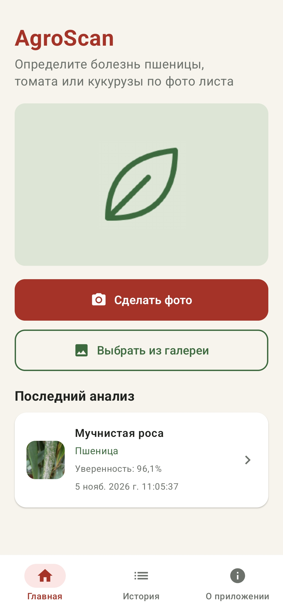
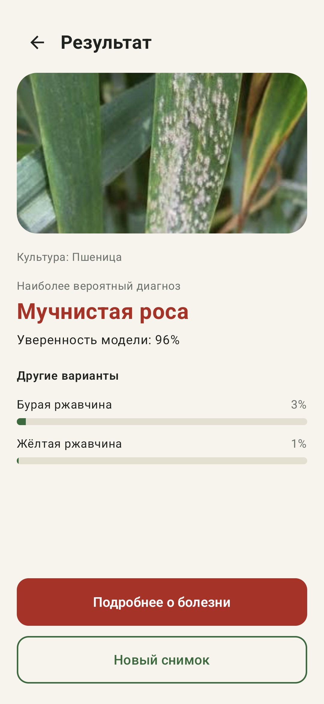
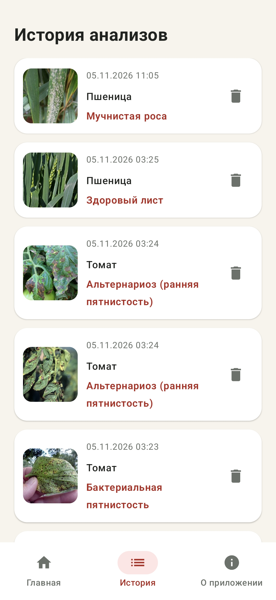

# AgroScan

**AgroScan** — Android-приложение для автоматического определения заболеваний сельскохозяйственных культур по фотографии листьев. Проект объединяет технологии компьютерного зрения и машинного обучения, чтобы сделать предварительную диагностику растений доступной непосредственно со смартфона.

Приложение поддерживает три культуры: томат, кукурузу и пшеницу. Достаточно сделать снимок или выбрать изображение из галереи — AgroScan определит культуру, проанализирует состояние листа и покажет предполагаемое заболевание с оценкой уверенности модели.

Все вычисления выполняются непосредственно на устройстве. Подключение к интернету не требуется, фотографии не отправляются на внешние серверы.

<table>
  <tr>
    <td align="center">
      <br>
      <sub>Главный экран</sub>
    </td>
    <td align="center">
      <br>
      <sub>Результат анализа</sub>
    </td>
    <td align="center">
      <br>
      <sub>Результат анализа</sub>
    </td>
  </tr>
</table>

## Возможности

- **Поддержка трёх культур:** томаты, кукуруза и пшеница.
- **Автоматическое определение культуры:** приложение определяет, к какой культуре относится растение на фотографии.
- **Диагностика заболеваний:** анализ состояния листа с использованием специализированной модели для соответствующей культуры.
- **Работа с изображениями:** съёмка камерой смартфона или выбор фотографии из галереи.
- **Оценка уверенности:** отображение предполагаемого заболевания и уверенности модели в процентах.
- **Информация о заболеваниях:** описание обнаруженных заболеваний.
- **Автономная работа:** обработка изображений непосредственно на устройстве без подключения к интернету.

## Как работает приложение

AgroScan использует последовательную обработку изображения с помощью моделей компьютерного зрения.

1. **Получение изображения.** Пользователь фотографирует лист растения или выбирает готовое изображение из галереи.
2. **Определение культуры.** Модель обнаружения определяет тип культуры на изображении.
3. **Классификация состояния.** В зависимости от определённой культуры выбирается соответствующая модель классификации заболеваний.
4. **Получение результата.** Приложение отображает предполагаемое заболевание, уверенность модели и справочную информацию о выявленном состоянии.

Таким образом, для каждой поддерживаемой культуры используется специализированная модель, что позволяет учитывать особенности заболеваний разных растений.

## Используемые технологии

| Компонент | Технологии |
|---|---|
| Платформа | Android |
| Язык программирования | Kotlin |
| Пользовательский интерфейс | Jetpack Compose |
| Определение культуры | YOLO |
| Классификация заболеваний | EfficientNet-B0 |
| Формат моделей | ONNX |
| Выполнение моделей | ONNX Runtime |
| Система сборки | Gradle |

Модели интегрированы непосредственно в приложение и выполняются локально на устройстве.

## Быстрый старт

Для сборки проекта понадобятся:
- Android Studio;
- JDK;
- Android SDK;
- устройство или эмулятор Android.

Минимальная версия Android и остальные параметры сборки указаны в `app/build.gradle.kts`.

### Получение исходного кода

```bash
git clone https://github.com/zen256/AgroScan.git
cd AgroScan
```

### Запуск приложения

1. Откройте проект в Android Studio.
2. Дождитесь синхронизации Gradle.
3. Подключите Android-устройство или запустите эмулятор.
4. Выберите конфигурацию запуска и нажмите **Run**.

### Сборка APK

Для сборки отладочной версии выполните:

```bash
./gradlew assembleDebug
```

Готовый APK будет находиться в:

```text
app/build/outputs/apk/debug/
```

Для сборки релизной версии:

```bash
./gradlew assembleRelease
```

## Как пользоваться

1. Откройте AgroScan.
2. Сделайте фотографию листа или выберите изображение из галереи.
3. Запустите анализ.
4. Дождитесь завершения обработки изображения.
5. Ознакомьтесь с результатом классификации и информацией о заболевании.

Для получения более достоверного результата рекомендуется фотографировать лист крупным планом, при хорошем освещении и без размытия.

Подробное описание интерфейса и последовательности действий приведено в [пользовательском сценарии](docs/user_scenario.md).

## Модели и данные

Для определения культуры и классификации заболеваний используются модели компьютерного зрения, обученные на специализированных наборах изображений.

Для каждой поддерживаемой культуры предусмотрена отдельная документация, содержащая информацию о датасетах, подготовке данных, обучении и характеристиках соответствующих моделей.

Подробная техническая документация:

- [Документация по моделям и датасетам](docs/models/)

## Ограничения

- Поддерживаются только томаты, кукуруза и пшеница.
- Модель может ошибаться при плохом освещении, размытии, нестандартном ракурсе или низком качестве фотографии.
- Заболевания, отсутствующие среди обучающих классов, могут быть ошибочно отнесены к одному из известных состояний.
- Оценка уверенности модели не является гарантией правильности диагноза.
- Результаты приложения носят справочный характер и не заменяют профессиональную диагностику агронома.

## Документация

- [Пользовательский сценарий](docs/user_scenario.md)
- [Документация по моделям и датасетам](docs/models/)
- [Отчёты о разработке](docs/reports/stages-1-16.md)