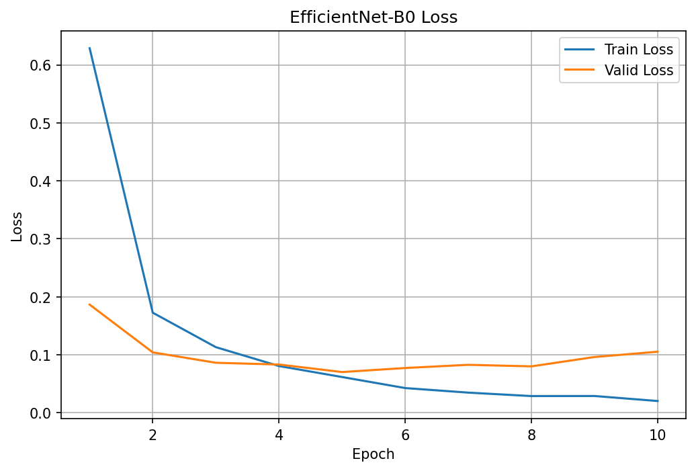
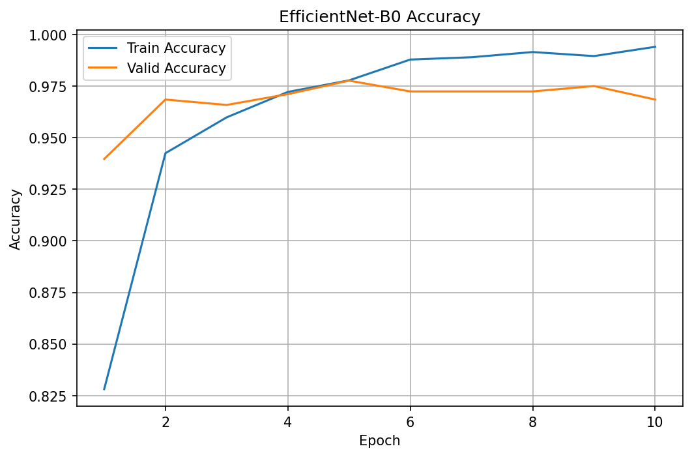
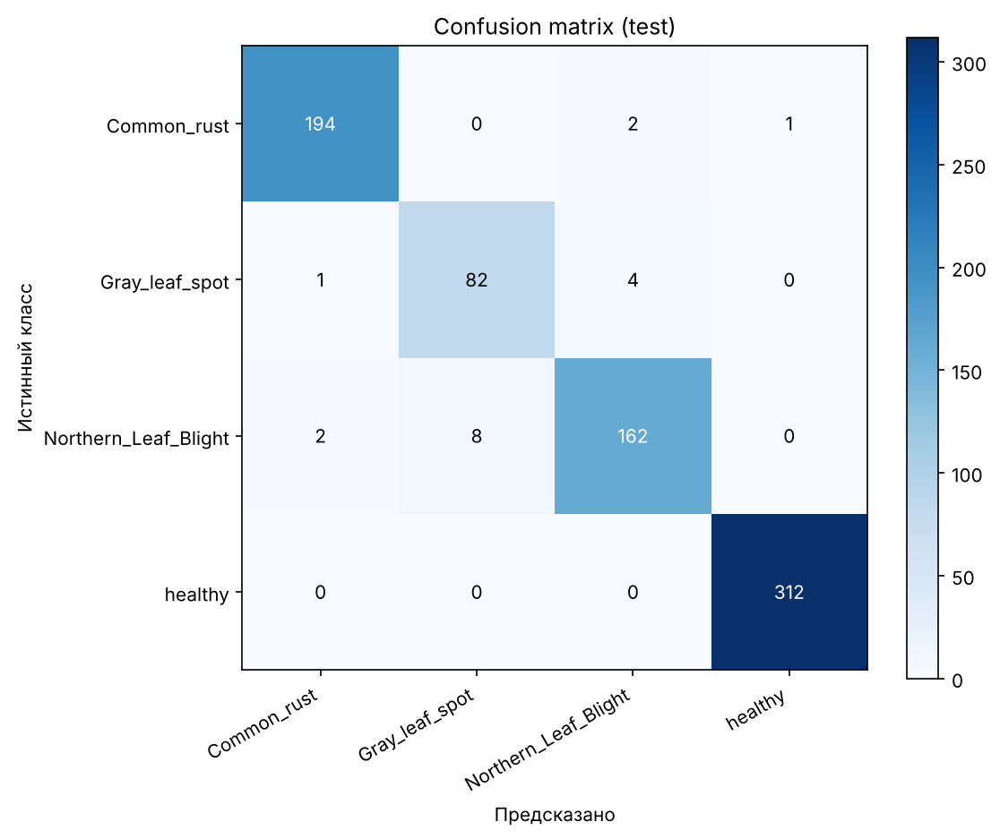

# Модель

Документ описывает нейросеть для распознавания болезней кукурузы в TomatoCare: архитектуру, обучение, экспорт в ONNX и интеграцию в приложение.

## Кратко

| Параметр | Значение |
|---|---|
| Архитектура | EfficientNet-B0 (предобучена на ImageNet, дообучена целиком) |
| Задача | классификация на 4 класса |
| Вход | RGB-изображение 224 × 224 |
| Выход | 4 значения (логиты), по одному на класс |
| Фреймворк обучения | PyTorch + torchvision |
| Формат в приложении | ONNX, один файл `efficientnet_b0.onnx` |
| Точность на тесте | 97,66 % (768 изображений) |

## Обучение

Скрипт: `ml/corn/train_efficientnet.py`. Он ожидает папку `dataset/` с подпапками `train/`, `valid/`, `test/` в каталоге запуска, поэтому запускать его нужно из папки, в которой лежит `dataset/`.

Последний слой `classifier[1]` заменён на `Linear(1280, 4)`; остальные веса стартуют с ImageNet и тоже обучаются (заморозки слоёв нет).

| Параметр | Значение |
|---|---|
| Размер изображения | 224 × 224 (прямое масштабирование без обрезки) |
| Размер батча | 64 |
| Число эпох | 10 |
| Оптимизатор | AdamW |
| Learning rate | 0,0001 |
| Weight decay | 0,0001 |
| Функция потерь | CrossEntropyLoss |
| Аугментация | отражение по горизонтали, поворот ±15°, ColorJitter (яркость, контраст, насыщенность по 0,2) |
| Нормализация | mean = [0.485, 0.456, 0.406], std = [0.229, 0.224, 0.225] |
| Устройство | CUDA (GPU, Google Colab, T4) |

Лучшая эпоха выбирается по минимуму val_loss на `valid`: это 5-я эпоха (val_loss = 0,0704, valid accuracy = 0,9777). Её веса сохраняются и затем один раз проверяются на `test`.

Со 6-й эпохи val_loss перестаёт уменьшаться и к 10-й растёт (0,1054), а точность на train продолжает расти (до 0,9941): это признак начинающегося переобучения, поэтому отбор по минимуму val_loss здесь оправдан.

В скрипте не зафиксирован random seed, поэтому повторный запуск даст близкие, но не идентичные результаты.

Зависимости обучения: `torch`, `torchvision`, `scikit-learn`, `matplotlib`.

## Результаты

| Метрика | Значение |
|---|---|
| Test accuracy | 0,9766 |
| Test loss | 0,0686 |
| Macro precision / recall / F1 | 0,9642 / 0,9673 / 0,9657 |
| Weighted F1 | 0,9766 |

Метрики по классам (тест, 768 изображений):

| Класс | Precision | Recall | F1 | Изображений |
|---|---|---|---|---|
| `Common_rust` | 0,9848 | 0,9848 | 0,9848 | 197 |
| `Gray_leaf_spot` | 0,9111 | 0,9425 | 0,9266 | 87 |
| `Northern_Leaf_Blight` | 0,9643 | 0,9419 | 0,9529 | 172 |
| `healthy` | 0,9968 | 1,0000 | 0,9984 | 312 |

Матрица ошибок (строки — истинный класс, столбцы — предсказанный):

| | Common_rust | Gray_leaf_spot | Northern_Leaf_Blight | healthy |
|---|---|---|---|---|
| **Common_rust** | 194 | 0 | 2 | 1 |
| **Gray_leaf_spot** | 1 | 82 | 4 | 0 |
| **Northern_Leaf_Blight** | 2 | 8 | 162 | 0 |
| **healthy** | 0 | 0 | 0 | 312 |

Здоровый лист распознаётся безошибочно (recall = 1,00). Основные ошибки — между двумя пятнистостями: 8 изображений `Northern_Leaf_Blight` предсказаны как `Gray_leaf_spot` и 4 изображения `Gray_leaf_spot` — как `Northern_Leaf_Blight`. Обе болезни дают вытянутые бурые пятна на листе и визуально похожи. Кроме того, `Gray_leaf_spot` самый малочисленный класс (571 изображение, 87 в тесте): у него самые низкие precision и F1, а одна ошибка меняет recall примерно на 1,1 п. п.

## Проверка на реальных фотографиях из интернета

Модель проверена на фотографиях из интернета, которых нет в обучающем датасете (скрипт `ml/corn/predict_real.py`). Проведено два независимых прогона.

**Прогон 1: смешанный набор (дальние планы, сложные сцены) — 7 из 16.**

| Класс | Верно |
|---|---|
| `Common_rust` | 3 из 4 |
| `Gray_leaf_spot` | 0 из 4 |
| `Northern_Leaf_Blight` | 4 из 4 |
| `healthy` | 0 из 4 |

Здоровые листья и `Gray_leaf_spot` модель в основном относила к `Northern_Leaf_Blight`, причём с высокой уверенностью (0,97–0,99 для `healthy`). Снимки были сделаны издалека или в сложной обстановке и сильно отличались от обучающих данных, где лист снят крупно.

**Прогон 2: крупные планы листа в разной обстановке (сценарий использования приложения) — 24 из 24.**

| Класс | Верно | Уверенность (диапазон) |
|---|---|---|
| `Common_rust` | 6 из 6 | 0,52–1,00 |
| `Gray_leaf_spot` | 6 из 6 | 0,46–0,94 |
| `Northern_Leaf_Blight` | 6 из 6 | 0,95–1,00 |
| `healthy` | 6 из 6 | 0,53–0,96 |

**Выводы.** При съёмке листа крупным планом, как это будет делать пользователь приложения, модель работает хорошо, но на дальних планах и сложных сценах качество резко падает. Наборы небольшие, подбирались вручную, второй — после первого прогона, поэтому оценка 24/24 ориентировочная (нижняя граница 95 % доверительного интервала около 86 %) и не заменяет метрику на тесте. Уверенность на `Gray_leaf_spot` и `healthy` в ряде случаев низкая (около 0,5).

## Файлы модели

| Файл | Назначение |
|---|---|
| `efficientnet_b0_best.pth` | веса PyTorch: `model_state_dict`, список классов, размер изображения |
| `efficientnet_b0.onnx` | модель для приложения (`app/src/main/assets/`) |
| `classes.json` | названия классов в порядке выходов модели |

## Экспорт в ONNX

Скрипт: `ml/corn/export_onnx.py`.

Модель необходимо сохранять **одним файлом**. При экспорте с внешними весами рядом появляется файл `.onnx.data`; если его не положить в `assets` вместе с `.onnx`, ONNX Runtime в приложении не сможет загрузить модель, и анализ завершится ошибкой. Поэтому в приложение добавляется только самодостаточный `efficientnet_b0.onnx`.

Вход модели — тензор `(1, 3, 224, 224)`. Сверка с PyTorch на 200 случайных тестовых изображениях: класс совпадает в 200 из 200 случаев, максимальное расхождение логитов 1,6·10⁻⁴, accuracy на этой выборке одинаковая (0,9750).

## Интеграция в приложение

Предобработка в приложении должна в точности повторять предобработку при обучении:

1. Изображение приводится к RGB.
2. Масштабируется до 224 × 224 напрямую, без обрезки по центру и без сохранения пропорций.
3. Значения пикселей переводятся в диапазон 0–1 и нормализуются (mean и std из таблицы выше).
4. Формируется тензор `float32` формы `[1, 3, 224, 224]` (порядок каналов CHW).
5. Модель возвращает 4 логита; к ним применяется softmax. Индекс максимума сопоставляется с `classes.json`, значение максимума — уверенность модели.

Расхождения в любом из пунктов (порядок каналов, нормализация, другой способ масштабирования) дают заметное падение точности без каких-либо ошибок в работе приложения. Порядок классов в `classes.json` должен совпадать с порядком выходов модели.
