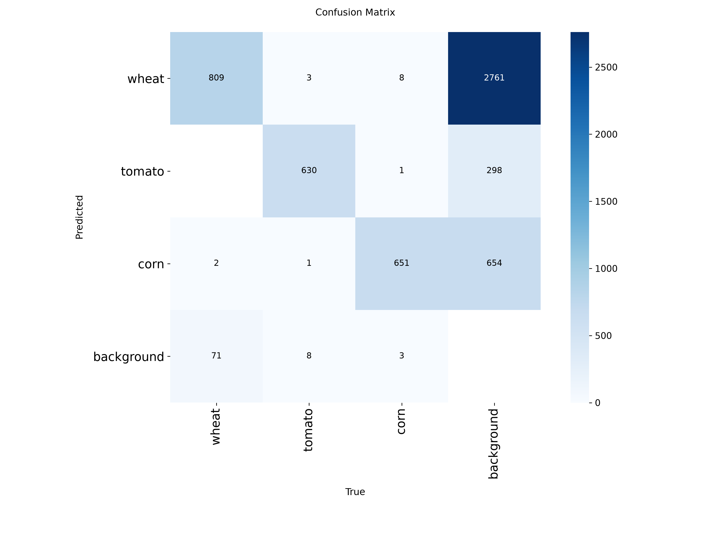
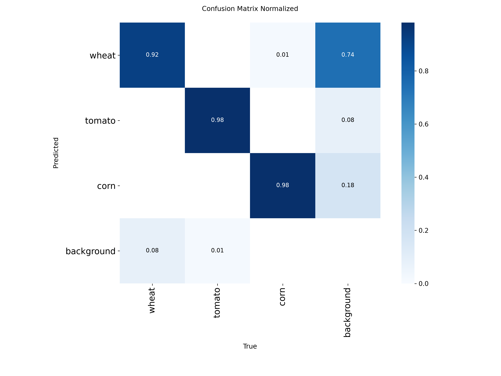
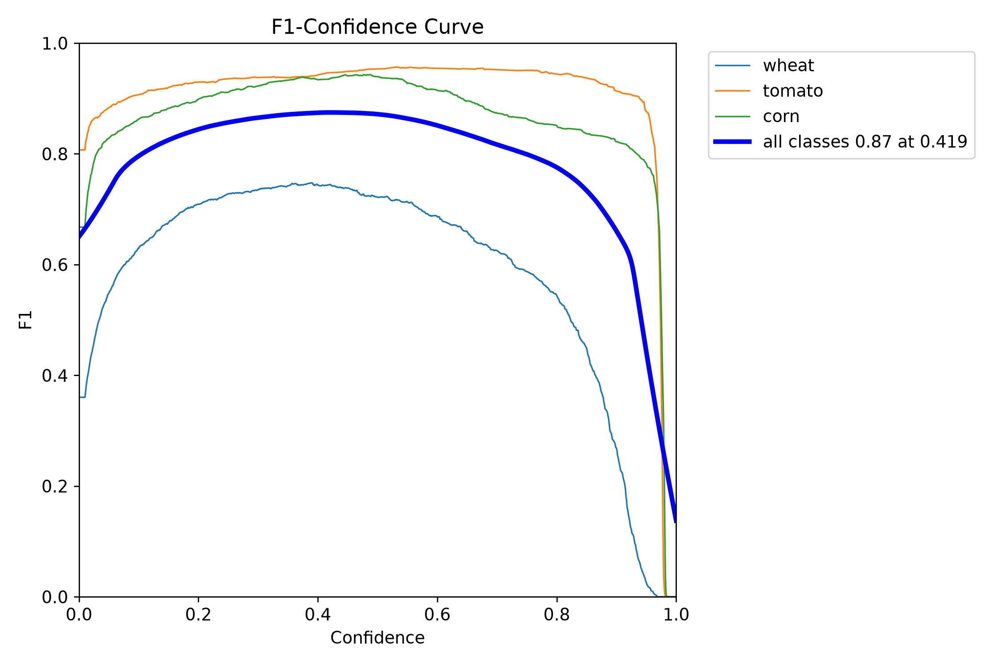
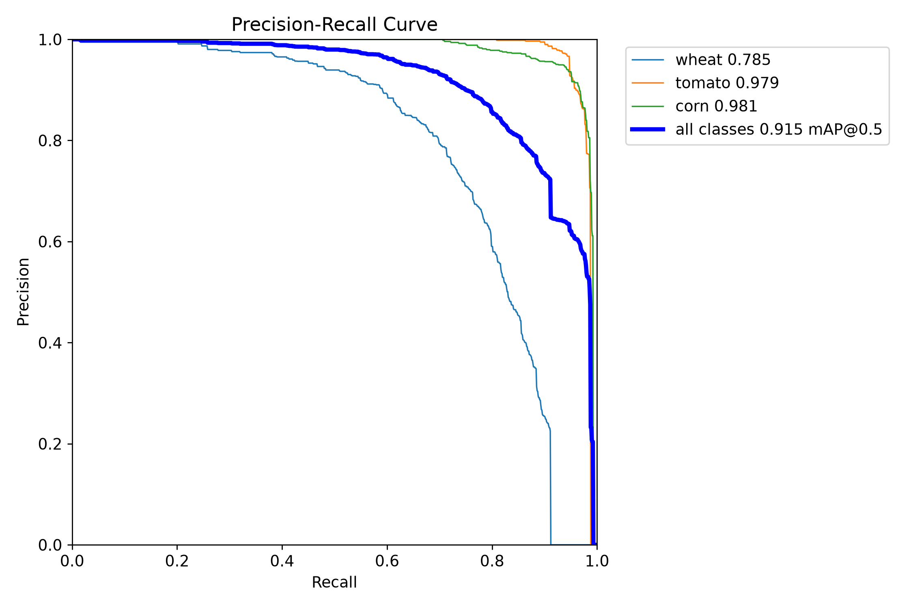
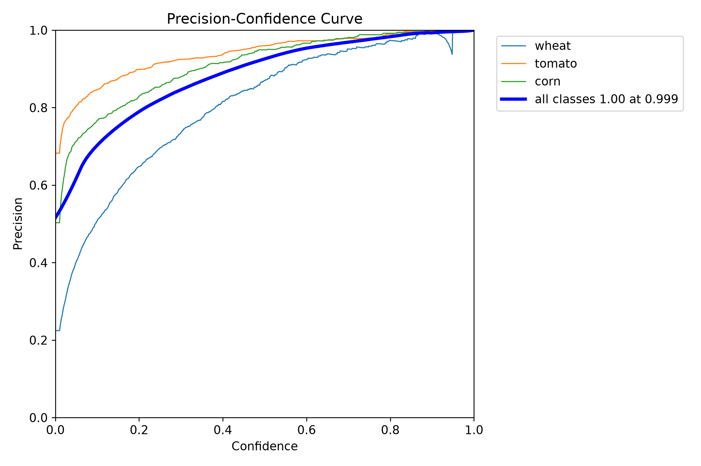
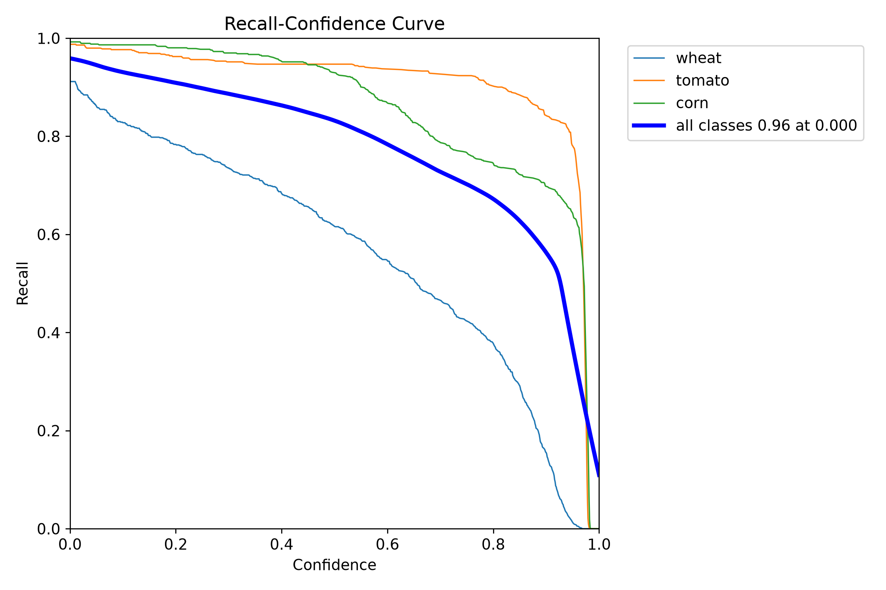

# Модель

Документ описывает нейросеть для определения культуры листа (пшеница, томат, кукуруза): архитектуру, обучение, результаты оценки и подготовку модели.

## Кратко

| Параметр | Значение |
|---|---|
| Архитектура | YOLO26s-OBB |
| Задача | Oriented Object Detection (OBB) + определение культуры |
| Классы | `wheat`, `tomato`, `corn` |
| Вход | RGB-изображение 640 × 640 |
| Фреймворк | Ultralytics YOLO |
| Лучший результат | эпоха 41 |

## Обучение

Модель обучалась на датасете с разбиением train / val / test. Выбор лучшей модели выполнялся по валидационной выборке. Тестовая выборка не использовалась при обучении и выборе checkpoint.

### Параметры обучения

| Параметр | Значение |
|---|---|
| Модель | `yolo26s-obb.pt` |
| Размер изображения | 640 |
| Batch size | 16 |
| Количество эпох | 100 (ранняя остановка) |
| Patience | 20 |
| Оптимизатор | auto |
| Seed | 42 |
| AMP | включён |
| Устройство | CUDA |

Обучение остановлено по EarlyStopping. Лучший результат получен на **41-й эпохе**.

## Результаты

### Общие метрики на тестовой выборке

| Метрика | Значение |
|---|---:|
| Precision | 0,8986 |
| Recall | 0,8578 |
| mAP@50 | 0,9147 |
| mAP@50-95 | 0,8034 |
| Fitness | 0,8034 |

### Метрики по классам (тестовая выборка)

| Класс | Precision | Recall | mAP@50 | mAP@50-95 | Изображений | Экземпляров |
|---|---:|---:|---:|---:|---:|---:|
| `wheat` | 0,830 | 0,675 | 0,785 | 0,571 | 519 | 882 |
| `tomato` | 0,946 | 0,947 | 0,979 | 0,947 | 553 | 642 |
| `corn` | 0,920 | 0,952 | 0,981 | 0,893 | 508 | 663 |
| **all** | **0,899** | **0,858** | **0,915** | **0,803** | **1580** | **2187** |

### Анализ по классам

- **tomato** — самый уверенный класс (высокий Precision, Recall и mAP).
- **corn** — также показывает высокие результаты.
- **wheat** — наиболее сложный класс: заметно ниже Recall и mAP@50-95.

### Матрица ошибок

Матрица ошибок построена по результатам классификации тестовой выборки. Строки соответствуют истинным классам, столбцы — предсказанным.

Порядок классов:

1. `wheat`
2. `tomato`
3. `corn`
4. `background`

Основная часть ошибок связана с классом `wheat` (пропуски и путаница с фоном). Классы `tomato` и `corn` распознаются значительно стабильнее.

### Кривые качества

## Ограничения

- Тестовая выборка состоит из изображений исходных датасетов, а не из независимой полевой съёмки.
- Класс `wheat` показывает заметно более низкие метрики по сравнению с `tomato` и `corn`.
- Высокие значения mAP на тесте не гарантируют такую же точность на пользовательских фотографиях с другим качеством, освещением и фоном.
- Для практического использования рекомендуется дополнительная проверка на реальных полевых снимках и настройка порога уверенности.
