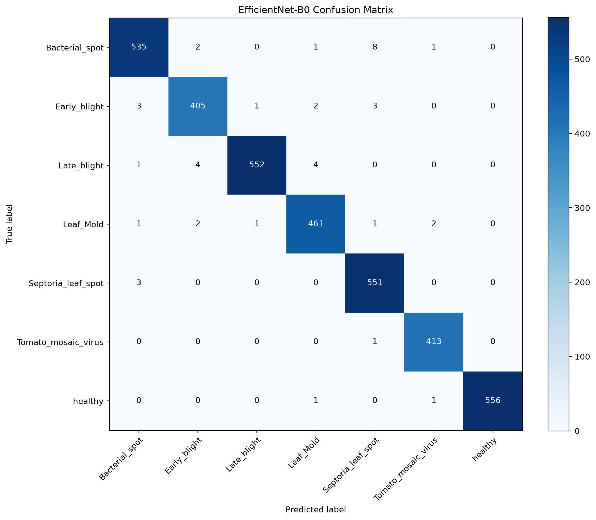

# Модель

Документ описывает нейросеть для распознавания болезней томата в TomatoCare: архитектуру, обучение, результаты оценки и подготовку модели для интеграции в приложение.

## Кратко

| Параметр | Значение |
|---|---|
| Архитектура | EfficientNet-B0 |
| Предобучение | ImageNet |
| Задача | Классификация на 7 классов |
| Вход | RGB-изображение 224 × 224 |
| Выход | 7 логитов, по одному на класс |
| Фреймворк | PyTorch + torchvision |
| Оптимизатор | AdamW |
| Точность на тесте | 98,78 % (3 516 изображений) |
| Лучший checkpoint | `efficientnet_b0_best.pth` |
| Список классов | `classes.json` |

## Обучение

Скрипт: `train_efficientnet.py`.

Он ожидает структуру датасета с каталогами `train/`, `valid/` и `test/` в текущей рабочей директории.

Модель загружается с предобученными весами `EfficientNet_B0_Weights.DEFAULT`. Последний слой классификатора `classifier[1]` заменяется на `Linear(1280, 7)`. Все параметры модели доступны для обучения.

### Параметры обучения

| Параметр | Значение |
|---|---|
| Размер изображения | 224 × 224 |
| Batch size | 64 |
| Количество эпох | 10 |
| Learning rate | 0,0001 |
| Weight decay | 0,0001 |
| Оптимизатор | AdamW |
| Функция потерь | CrossEntropyLoss |
| Количество workers | 4 |
| Устройство | CUDA |
| Выбор лучшей модели | Максимальная `valid_accuracy` |

### Предобработка изображений

Все изображения масштабируются до 224 × 224 без обрезки.

Для обучающей выборки применяются:
- Случайное горизонтальное отражение с вероятностью 0,5.
- Случайный поворот до ±15°.
- Случайное изменение яркости, контраста и насыщенности с параметрами 0,2.

Для валидационной и тестовой выборок выполняются только масштабирование и нормализация.

Нормализация использует параметры ImageNet:

```python
mean = [0.485, 0.456, 0.406]
std = [0.229, 0.224, 0.225]
```

### Выбор checkpoint

Лучшая модель выбирается по максимальной точности на валидационной выборке (`valid_accuracy`).

Наилучший результат получен на 8-й эпохе:

| Метрика | Значение |
|---|---:|
| Train accuracy на 8-й эпохе | 0,9901 |
| Valid accuracy | 0,9877 |

При улучшении валидационной точности веса модели сохраняются в `efficientnet_b0_best.pth`. После завершения обучения эти веса загружаются для итоговой оценки на тестовой выборке.

## Результаты

### Общие метрики

| Метрика | Значение |
|---|---:|
| Test loss | 0,0543 |
| Test accuracy | 0,9878 |
| Macro precision | 0,9875 |
| Macro recall | 0,9877 |
| Macro F1-score | 0,9876 |
| Weighted F1-score | 0,9878 |

Точность классификации на тестовой выборке составляет 98,78 %.

### Метрики по классам

| Класс | Precision | Recall | F1-score | Изображений |
|---|---:|---:|---:|---:|
| `Bacterial_spot` | 0,9853 | 0,9781 | 0,9817 | 547 |
| `Early_blight` | 0,9806 | 0,9783 | 0,9794 | 414 |
| `Late_blight` | 0,9964 | 0,9840 | 0,9901 | 561 |
| `Leaf_Mold` | 0,9829 | 0,9850 | 0,9840 | 468 |
| `Septoria_leaf_spot` | 0,9770 | 0,9946 | 0,9857 | 554 |
| `Tomato_mosaic_virus` | 0,9904 | 0,9976 | 0,9940 | 414 |
| `healthy` | 1,0000 | 0,9964 | 0,9982 | 558 |

### Матрица ошибок

Матрица ошибок построена по результатам классификации тестовой выборки. Строки соответствуют истинным классам, столбцы – предсказанным.



Порядок классов на обеих осях:

1. `Bacterial_spot`
2. `Early_blight`
3. `Late_blight`
4. `Leaf_Mold`
5. `Septoria_leaf_spot`
6. `Tomato_mosaic_virus`
7. `healthy`

Из 3 516 тестовых изображений правильно классифицировано 3 473, ошибочно – 43.

Наименьший F1-score получен для `Early_blight` (0,9794), наибольший – для `healthy` (0,9982). При этом показатели всех семи классов превышают 0,97.

## Файлы модели

После обучения создаются:

| Файл | Назначение |
|---|---|
| `efficientnet_b0_best.pth` | Веса лучшей модели, список классов и размер входного изображения |
| `classes.json` | Порядок классов для интерпретации выходных логитов |
| `efficientnet_b0_loss.png` | График функции потерь |
| `efficientnet_b0_accuracy.png` | График точности обучения и валидации |
| `confusion_matrix.png` | Матрица ошибок |

## Ограничения

- Тестовая выборка состоит из изображений исходных публичных датасетов, а не из независимой выборки фотографий, сделанных в реальных условиях Беларуси.
- Точность 98,78 % характеризует только текущую тестовую выборку и не гарантирует аналогичного результата на пользовательских фотографиях.
