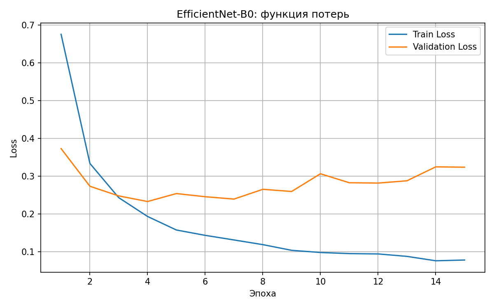
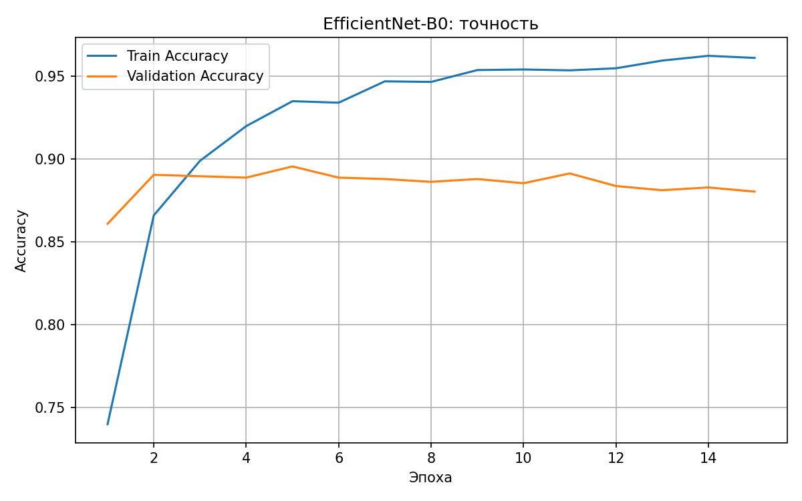
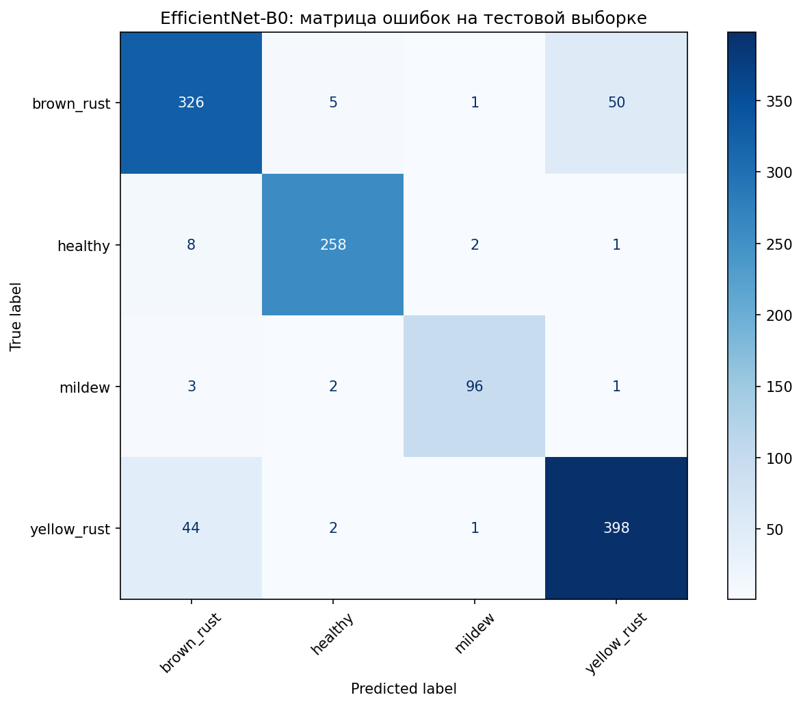

# Модель

Документ описывает нейросеть для распознавания болезней кукурузы в TomatoCare: архитектуру, обучение, экспорт в ONNX и интеграцию в приложение.

## Кратко

| Параметр | Значение |
|---|---|
| Архитектура | EfficientNet-B0 (предобучена на ImageNet, дообучена целиком) |
| Задача | классификация на 4 класса |
| Вход | RGB-изображение 224 × 224 |
| Выход | 4 значения (логиты), по одному на класс |
| Фреймворк обучения | PyTorch + torchvision |
| Формат в приложении | ONNX, один файл `efficientnet_b0.onnx` |
| Точность на тесте | 89,98 % (1198 изображений) |

## Обучение

Скрипт: `ml/wheat/train_wheat_efficientnet_b0.py`. Он ожидает папку `dataset/` с подпапками `train/`, `valid/`, `test/` в каталоге запуска, поэтому запускать его нужно из папки, в которой лежит `dataset/`.

Последний слой `classifier[1]` заменён на `Linear(1280, 4)`; остальные веса стартуют с ImageNet и тоже обучаются (заморозки слоёв нет).

| Параметр | Значение |
|---|---|
| Размер изображения | 224 × 224 (прямое масштабирование без обрезки) |
| Размер батча | 32 |
| Число эпох | 15 |
| Оптимизатор | AdamW |
| Learning rate | 0,0001 |
| Weight decay | 0,0001 |
| Функция потерь | CrossEntropyLoss |
| Аугментация | отражение по горизонтали, поворот ±10°, ColorJitter (яркость, контраст, насыщенность по 0,15) |
| Нормализация | mean = [0.485, 0.456, 0.406], std = [0.229, 0.224, 0.225] |
| Устройство | CUDA (GPU, Google Colab, T4) |

Лучшая эпоха выбирается по минимуму val_loss на `valid`: это 4-я эпоха (val_loss = 0,2327, valid accuracy = 0,8887). Её веса сохраняются и затем один раз проверяются на `test`.

Со 5-й эпохи val_loss перестаёт уменьшаться и к 15-й растёт (0,3235), а точность на train продолжает расти (до 0,9609): это признак начинающегося переобучения, поэтому отбор по минимуму val_loss здесь оправдан.

В скрипте не зафиксирован random seed, поэтому повторный запуск даст близкие, но не идентичные результаты.

Зависимости обучения: `torch`, `torchvision`, `scikit-learn`, `matplotlib`.

## Результаты

| Метрика | Значение |
|---|---|
| Test accuracy | 0,8998 |
| Test loss | 0,2330 |
| Macro precision / recall / F1 | 0,9166 / 0,9120 / 0,9143 |
| Weighted F1 | 0,8999 |

Метрики по классам (тест, 768 изображений):

| Класс | Precision | Recall | F1 | Изображений |
|---|---|---|---|---|
| `brown_rust` | 0,8556 | 0,8534 | 0,8545 | 382 |
| `healthy` | 0,9663 | 0,9591 | 0,9627 | 269 |
| `mildew` | 0,9600 | 0,9412 | 0,9505 | 102 |
| `yellow_rust` | 0,8844 | 0.8944 | 0,8894 | 445 |

Матрица ошибок (строки — истинный класс, столбцы — предсказанный):

| | brown_rust | healthy | mildew | yellow_rust |
|---|---|---|---|---|
| **brown_rust** | 326 | 5 | 1 | 50 |
| **healthy** | 8 | 258 | 2 | 1 |
| **mildew** | 3 | 2 | 96 | 1 |
| **yellow_rust** | 44 | 2 | 1 | 398 |

Основные ошибки — между двумя ржавчинами: 50 изображений `brown_rust` предсказаны как `yellow_rust` и 44 изображения `yellow_rust` — как `brown_rust`. Обе болезни визуально похожи. 

## Файлы модели

| Файл | Назначение |
|---|---|
| `efficientnet_b0_best.pth` | веса PyTorch: `model_state_dict`, список классов, размер изображения |
| `efficientnet_b0.onnx` | модель для приложения (`app/src/main/assets/`) |
| `classes.json` | названия классов в порядке выходов модели |

## Экспорт в ONNX

Скрипт: `ml/wheat/export_onnx.py`.

Модель необходимо сохранять **одним файлом**. При экспорте с внешними весами рядом появляется файл `.onnx.data`; если его не положить в `assets` вместе с `.onnx`, ONNX Runtime в приложении не сможет загрузить модель, и анализ завершится ошибкой. Поэтому в приложение добавляется только самодостаточный `efficientnet_b0.onnx`.

Вход модели — тензор `(1, 3, 224, 224)`. Сверка с PyTorch на 200 случайных тестовых изображениях: класс совпадает в 200 из 200 случаев, максимальное расхождение логитов 1,74·10⁻5, accuracy на этой выборке одинаковая (0,89).

## Интеграция в приложение

Предобработка в приложении должна в точности повторять предобработку при обучении:

1. Изображение приводится к RGB.
2. Масштабируется до 224 × 224 напрямую, без обрезки по центру и без сохранения пропорций.
3. Значения пикселей переводятся в диапазон 0–1 и нормализуются (mean и std из таблицы выше).
4. Формируется тензор `float32` формы `[1, 3, 224, 224]` (порядок каналов CHW).
5. Модель возвращает 4 логита; к ним применяется softmax. Индекс максимума сопоставляется с `classes.json`, значение максимума — уверенность модели.

Расхождения в любом из пунктов (порядок каналов, нормализация, другой способ масштабирования) дают заметное падение точности без каких-либо ошибок в работе приложения. Порядок классов в `classes.json` должен совпадать с порядком выходов модели.
